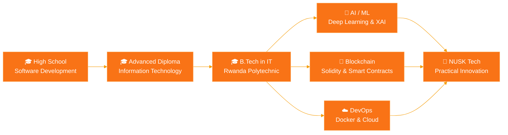

 

---

## 🚀 About

I build practical, data-driven software for real businesses: full-stack applications, relational databases, and the deployment and support that keep them running. I hold a B.Tech in Information Technology (Rwanda Polytechnic) and I'm Co-Founder & CEO of [**NUSK Tech Solutions Group**](https://nusk.rw).

Currently exploring **machine learning** and **blockchain development**.

---

## 🛠️ Tech Stack

  
   
  

---

### 🧭 Learning Path

---

## 📌 Featured Projects

### 🔗 Open-Source & Research Work

| Project | Stack | Description |
|---|---|---|
| [**blockchain-escrow-system**](https://github.com/ndayizeyekevin/blockchain-escrow-system) | JavaScript | Blockchain-based escrow system |
| [**blockchain-temperature-based-vaccine-logistics**](https://github.com/ndayizeyekevin/blockchain-temperature-based-vaccine-logistics) | JavaScript | Temperature-based vaccine logistics on the blockchain |
| [**eth-upgradeable-vault-uups**](https://github.com/ndayizeyekevin/eth-upgradeable-vault-uups) | JavaScript · Solidity | Upgradeable Ethereum vault using the UUPS pattern |
| [**smart-car-gate-system**](https://github.com/ndayizeyekevin/smart-car-gate-system) | Python | Smart car gate system |
| [**diabetes_prediction**](https://github.com/ndayizeyekevin/diabetes_prediction) | Jupyter Notebook | Machine learning model for diabetes prediction |

---

## 🤝 Connect With Me

I'm always open to connecting with fellow developers, technology enthusiasts, businesses, and potential collaborators.

  

### 💡 Building solutions. Learning continuously. Creating impact.

*"Smart technology, meaningful solutions, and continuous innovation."*

